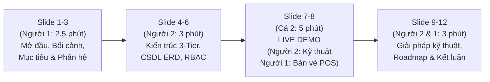

# KỊCH BẢN PHÂN VAI THUYẾT TRÌNH 2 NGƯỜI (PRESENTATION SCRIPT)
## DỰ ÁN: HỆ THỐNG QUẢN LÝ TÀU ĐIỆN ĐÔ THỊ (SUBWAY MANAGEMENT SYSTEM)

> **Thời lượng đề xuất:** 10 - 15 phút (Bao gồm Slide + Live Demo)  
> **Tài liệu nạp trực tiếp vào NotebookLM / Gemini để tự động tạo Slide thuyết trình và thẻ ghi nhớ (Flashcards/Speaker Notes).**

---

## 👥 1. BẢNG PHÂN VAI VÀ TRÁCH NHIỆM

| Vai Trò | Thành Viên | Trọng Tâm Trình Bày | Phong Thái / Tác Phong |
| :--- | :--- | :--- | :--- |
| **NGƯỜI 1** *(Presenter 1)* | **Business Analyst (BA) & Product Owner** | • Mở đầu & Giới thiệu đề tài • Bối cảnh bài toán & Mục tiêu nghiệp vụ • Tổng quan 15 Form & Ma trận phân quyền RBAC • **Live Demo**: Phân hệ Bán vé POS, Tra cứu & Hủy vé, Hành khách • Báo cáo thống kê Dashboard & Tổng kết giá trị dự án | Chững chạc, lưu loát, tập trung vào trải nghiệm người dùng, giá trị thực tiễn và quy trình dịch vụ hành khách. |
| **NGƯỜI 2** *(Presenter 2)* | **Tech Lead & System Architect** | • Kiến trúc phần mềm phân tầng (3-Tier) • Thiết kế CSDL 11 bảng chuẩn 3NF & Lược đồ ERD • Hệ thống 5 Stored Procedures mở rộng • **Live Demo**: Phân hệ Hạ tầng, Lịch trình, Tự động sinh chuyến, Kỹ thuật bảo trì tàu • Điểm sáng công nghệ (ACID Transaction, chống SQL Injection, UTF-8 BOM, fix WinForms layout) • Định hướng nâng cấp (Roadmap) | Vững vàng, khúc chiết, tự tin làm chủ công nghệ, mã nguồn và kiến trúc cơ sở dữ liệu. |

---

## ⏱️ 2. DÀN Ý THUYẾT TRÌNH THEO SLIDE & THỜI LƯỢNG

---

## 🎙️ 3. KỊCH BẢN CHI TIẾT TỪNG SLIDE (WORD-FOR-WORD SCRIPT)

---

### SLIDE 1: TRANG TIÊU ĐỀ & GIỚI THIỆU NHÓM (0.5 phút)
* **Tiêu đề Slide**: Hệ Thống Quản Lý Tàu Điện Đô Thị (Subway Management System)
* **Nội dung hiển thị**: Tên dự án, Công nghệ áp dụng (C# WinForms .NET 4.7.2, SQL Server), Thông tin giảng viên hướng dẫn & thành viên nhóm.

**🎤 NGƯỜI 1 trình bày:**
> *"Kính chào quý Thầy/Cô trong Hội đồng và các bạn sinh viên có mặt trong buổi báo cáo hôm nay.  
> Nhóm chúng em gồm 2 thành viên: Em là **[Tên Người 1]** - đảm nhận vai trò phân tích nghiệp vụ và trải nghiệm sản phẩm, và bạn **[Tên Người 2]** - đảm nhận vai trò kiến trúc hệ thống và phát triển kỹ thuật.  
> Hôm nay, nhóm chúng em xin trân trọng giới thiệu đề tài: **Hệ thống Quản lý Tàu điện Đô thị (Subway Management System)** - một giải pháp phần mềm toàn diện nhằm tự động hóa và nâng cao năng lực vận hành đường sắt đô thị hiện đại."*

---

### SLIDE 2: BỐI CẢNH ĐÔ THỊ & BÀI TOÁN THỰC TẾ (1 phút)
* **Tiêu đề Slide**: Bối Cảnh Thực Tiễn & Nhu Cầu Chuyển Đổi Số Metro
* **Nội dung hiển thị**:
  - Tốc độ đô thị hóa nhanh, nhu cầu di chuyển bằng metro/subway tăng vọt (VD: Tuyến Metro Bến Thành - Suối Tiên, Cát Linh - Hà Đông).
  - Khó khăn trong vận hành thủ công: Dễ trùng lặp lịch chạy tàu, kiểm soát bảo dưỡng thiếu đồng bộ, quầy vé ùn tắc giờ cao điểm.
  - Giải pháp: Tin học hóa toàn diện từ quản lý hạ tầng ray, điều phối đoàn tàu, sinh chuyến tự động đến bán vé thông minh tại quầy.

**🎤 NGƯỜI 1 trình bày:**
> *"Thưa Thầy Cô, khi các tuyến tàu điện ngầm và đường sắt đô thị bắt đầu đi vào vận hành thực tế, khối lượng công việc quản lý là vô cùng khổng lồ: hàng trăm chuyến tàu mỗi ngày phải chạy đúng từng phút, các đoàn tàu phải bảo dưỡng nghiêm ngặt theo giờ quy định, và tại các nhà ga, hàng ngàn lượt khách mua vé mỗi giờ.  
> Nếu quản lý thủ công hoặc dùng các phần mềm rời rạc, doanh nghiệp sẽ gặp 3 bài toán nan giải:  
> 1. Dễ xảy ra xung đột, trùng lặp lịch trình vận hành.  
> 2. Khó giám sát tình trạng kỹ thuật và lịch sử sửa chữa đoàn tàu.  
> 3. Quầy bán vé dễ ùn tắc do việc tính giá vé chặng thủ công mất thời gian.  
> Xuất phát từ thực tế đó, nhóm chúng em đã nghiên cứu và phát triển phần mềm **Subway Management System** để giải quyết trọn vẹn chuỗi bài toán này."*

---

### SLIDE 3: TỔNG QUAN PHẠM VI 15 MÀN HÌNH CHỨC NĂNG (1 phút)
* **Tiêu đề Slide**: Cấu Trúc Hệ Thống & 15 Màn Hình Chức Năng (Forms)
* **Nội dung hiển thị**: Sơ đồ phân chia 4 phân hệ chính:
  1. **Hạ tầng đô thị**: Quản lý tuyến tàu (`FrmQuanLyTuyen`), Chi tiết ga dừng (`FrmChiTietTuyen`), Danh mục ga (`FrmQuanLyGa`).
  2. **Phương tiện & Kỹ thuật**: Đoàn tàu (`FrmQuanLyTau`), Chi tiết toa tàu (`FrmChiTietTau`), Lệnh bảo trì (`FrmBaoTri`).
  3. **Vận hành & Dịch vụ**: Lịch trình định kỳ (`FrmLichTrinh`), Chuyến tàu thực tế (`FrmChuyenTau`), Bán vé POS (`FrmBanVe`), Tra cứu & hủy vé (`FrmTraCuuVe`), Hồ sơ khách hàng (`FrmHanhKhach`).
  4. **Quản trị & Báo cáo**: Xác thực đăng nhập (`FrmDangNhap`), Dashboard tổng quan (`FrmTrangChu`), Nhân sự (`FrmNhanVien`), Báo cáo 3 Tab (`FrmBaoCao`).

**🎤 NGƯỜI 1 trình bày:**
> *"Hệ thống được thiết kế theo đúng quy chuẩn nghiệp vụ thực tế với trọn vẹn **15 màn hình chức năng**, phân bổ thành 4 phân hệ liên kết chặt chẽ: từ quản lý hạ tầng mạng lưới ga ray, đội tàu và bảo trì kỹ thuật, đến hệ thống lập lịch tự động, quầy bán vé POS và trung tâm báo cáo doanh thu quản trị.  
> Sau đây, em xin phép nhường lời cho bạn **[Tên Người 2]** để trình bày sâu hơn về nền tảng kiến trúc kỹ thuật và mô hình cơ sở dữ liệu của dự án."*

*(Người 1 chuyển micro / slide cho Người 2)*

---

### SLIDE 4: KIẾN TRÚC HỆ THỐNG PHÂN TẦNG (3-TIER ARCHITECTURE) (1 phút)
* **Tiêu đề Slide**: Kiến Trúc Phần Mềm 3 Tầng (Layered Architecture)
* **Nội dung hiển thị**: Sơ đồ 3 tầng: Presentation Layer (15 Forms WinForms) ➔ Data Access Layer (`Ketnoi_CSDL` Singleton, Parameterized Queries) ➔ Database Layer (SQL Server).

**🎤 NGƯỜI 2 trình bày:**
> *"Xin cảm ơn bạn [Tên Người 1]. Kính thưa Thầy/Cô, để đảm bảo hệ thống có độ ổn định cao, bảo mật và dễ mở rộng, nhóm đã lựa chọn kiến trúc **3 tầng (3-Tier)**:  
> - **Tầng Giao diện (Presentation Layer)**: Gồm 15 Forms Windows Forms thiết kế theo ngôn ngữ phẳng hiện đại, tối ưu cho nhân viên thao tác phím tắt cực nhanh.  
> - **Tầng Truy xuất Dữ liệu (Data Access Layer)**: Đóng gói tập trung trong lớp `Ketnoi_CSDL` theo mẫu thiết kế Singleton. Toàn bộ câu lệnh đều sử dụng `SqlParameter` và Stored Procedures, đảm bảo chống tấn công SQL Injection 100%. Lớp này đồng thời quản lý phiên làm việc toàn cục `NguoiDungHienTai`.  
> - **Tầng Cơ sở Dữ liệu (Database Layer)**: Sử dụng Microsoft SQL Server, đảm bảo toàn vẹn dữ liệu giao dịch thông qua các khóa ràng buộc và Stored Procedures tối ưu."*

---

### SLIDE 5: THIẾT KẾ CSDL 11 BẢNG & LƯỢC ĐỒ ERD (1.5 phút)
* **Tiêu đề Slide**: Mô Hình Cơ Sở Dữ Liệu & Lược Đồ Thực Thể Liên Kết (ERD)
* **Nội dung hiển thị**: Biểu đồ ERD 11 bảng chuẩn hóa 3NF, danh sách 5 Stored Procedures mở rộng (`sp_DangNhap`, `sp_ThongKeTrangChu`, `sp_SinhChuyen`, `sp_BanVe`, `sp_HuyVe`).

**🎤 NGƯỜI 2 trình bày:**
> *"Về cơ sở dữ liệu, dự án được chuẩn hóa ở mức **3NF** với **11 bảng quan hệ**:  
> - Cặp bảng `Tuyen` và `Ga` liên kết qua bảng trung gian `Tuyen_Ga` để xác định thứ tự ga và số phút dừng đón trả khách.  
> - Bảng `Tau` liên kết bảng `ToaTau` (1-n) giúp tính toán động sức chứa chỗ ngồi của đoàn tàu.  
> - Lịch trình định kỳ `LichTrinh` là căn cứ để bảng `ChuyenTau` sinh ra các chuyến chạy thực tế trong ngày, liên kết với nhân sự `NhanVien` đóng vai trò lái tàu.  
> - Nghiệp vụ bán vé thể hiện qua bảng `Ve`, kết nối giữa `ChuyenTau`, khách hàng `HanhKhach`, cùng 2 khóa ngoại ga đi (`MaGaDi`) và ga đến (`MaGaDen`).  
> - Đặc biệt, bảng `BaoTri` liên kết trực tiếp với `Tau` để tạo nên cơ chế đồng bộ trạng thái kỹ thuật tự động 2 chiều.  
> Ngoài ra, hệ thống tích hợp sẵn **5 Stored Procedures** giúp thực thi giao dịch bán vé an toàn (`sp_BanVe`), hủy vé (`sp_HuyVe`), sinh chuyến tự động (`sp_SinhChuyen`) và nạp thống kê Dashboard tức thời (`sp_ThongKeTrangChu`)."*

---

### SLIDE 6: MA TRẬN PHÂN QUYỀN TRUY CẬP (RBAC) (0.5 phút)
* **Tiêu đề Slide**: Kiểm Soát Truy Cập Dựa Trên Vai Trò (Role-Based Access Control)
* **Nội dung hiển thị**: Bảng ma trận 4 vai trò: `QuanLy` (Admin - 15 màn hình), `BanVe` (POS & Khách hàng), `KyThuat` (Đoàn tàu & Bảo trì), `LaiTau` (Lịch chạy phân công).

**🎤 NGƯỜI 2 trình bày:**
> *"Tính bảo mật của phần mềm được củng cố bằng cơ chế phân quyền RBAC phân cấp 4 nhóm quyền rõ rệt:  
> - **Quản Lý**: Toàn quyền cấu hình, nhân sự và báo cáo tài chính.  
> - **Bán Vé**: Chỉ được truy cập phân hệ bán vé, tra cứu và khách hàng.  
> - **Kỹ Thuật**: Quản lý tàu, cấu hình toa và lập phiếu bảo trì.  
> - **Lái Tàu**: Chỉ được xem các chuyến tàu mình được phân công phụ trách.  
> Giao diện Trang chủ sẽ tự động vô hiệu hóa và đổi màu các nút ngoài phạm vi quyền ngay sau khi đăng nhập."*

---

### SLIDE 7: LIVE DEMO PHẦN 1 - KỸ THUẬT & TỰ ĐỘNG HÓA VẬN HÀNH (2.5 phút)
* **Nội dung Demo trực tiếp trên phần mềm do NGƯỜI 2 thao tác:**

**🎤 NGƯỜI 2 trình bày (vừa nói vừa thao tác trên màn hình):**
> *"Bây giờ, em xin phép bắt đầu phần **Demo trực tiếp** các nghiệp vụ kỹ thuật và tự động hóa vận hành trên phần mềm:  
> 1. **Khởi động & Đăng nhập**: Em đăng nhập với tài khoản Kỹ thuật `kythuat` / mật khẩu `123456`. Thầy Cô có thể thấy Trang chủ chỉ mở các nút kỹ thuật, các nút bán vé và hạ tầng bị khóa xám.  
> 2. **Đồng bộ bảo trì đoàn tàu 2 chiều**: Em đăng nhập lại bằng `admin`, mở form **Quản Lý Tàu**. Tàu số 3 đang có trạng thái `Sẵn sàng`. Em mở form **Bảo Trì**, tạo một lệnh bảo trì mới cho Tàu số 3. Ngay lập tức, quay lại danh sách tàu, trạng thái Tàu số 3 đã tự động chuyển sang `Bảo trì`! Khi em bấm nút `Hoàn thành` trên phiếu bảo trì, hệ thống kiểm tra hết lệnh mở và tự động phục hồi tàu về `Sẵn sàng`. Đây là cơ chế tự động hóa bảo vệ an toàn chạy tàu.  
> 3. **Tự động sinh chuyến tàu**: Tại form **Lịch Trình**, lịch chạy định kỳ đã được cài đặt theo các thứ trong tuần. Em chỉ cần chọn ngày vận hành và bấm nút **'Sinh chuyến tự động'**, thủ tục `sp_SinhChuyen` sẽ quét lịch và tự động tạo chuyến trong ngày vào form **Quản Lý Chuyến Tàu**, phân công lái tàu mà không cần nhập thủ công từng chuyến."*

---

### SLIDE 8: LIVE DEMO PHẦN 2 - BÁN VÉ POS & DỊCH VỤ KHÁCH HÀNG (2.5 phút)
* **Nội dung Demo trực tiếp trên phần mềm do NGƯỜI 1 thao tác:**

*(Người 2 chuyển quyền điều khiển máy cho Người 1)*

**🎤 NGƯỜI 1 trình bày (vừa nói vừa thao tác trên màn hình):**
> *"Tiếp nối quy trình vận hành, em xin phép demo nghiệp vụ **Bán vé thông minh tại quầy (POS)**:  
> 1. **Chọn chuyến & Tính cước tự động**: Em mở form **Bán Vé Tại Quầy**. Chọn chuyến tàu số 1 thuộc Tuyến 01. Danh sách ga lập tức hiển thị đúng các ga của tuyến này.  
> Em chọn **Ga đi: Ga Bến Thành (thứ tự 1)**, **Ga đến: Ga Suối Tiên (thứ tự 7)**. Hệ thống tự động tính cự ly là **6 chặng** và áp mức giá **18.000 VNĐ**. Nếu em vô tình chọn ga đến nằm trước ga đi, hệ thống cảnh báo đỏ và khóa nút in vé ngay lập tức.  
> 2. **Chính sách ưu tiên**: Khi chuyển loại vé sang **'Ưu tiên'**, hệ thống tự động giảm ngay 30% giá vé, giá chỉ còn **12.600 VNĐ**.  
> 3. **Tra cứu khách hàng thân thiết**: Em nhập CCCD `079202699999` của khách quen, hệ thống tự động điền Họ tên và SĐT từ CSDL mà nhân viên không cần gõ lại.  
> 4. **Giao dịch Transaction an toàn & In vé**: Nhấn nút **'In Vé' (hoặc F5)**. Giao dịch `SqlTransaction` thực thi chớp nhoáng và popup hóa đơn chuẩn POS xuất hiện với đầy đủ mã vé, ga lên/xuống, loại vé và lời chúc hành khách.  
> 5. **Tra cứu & Hủy vé**: Tại form **Tra Cứu Vé**, vé vừa mua hiển thị ngay trên đầu danh sách. Khi hành khách yêu cầu đổi trả, nhân viên bấm **'Hủy vé'**, trạng thái vé chuyển sang `Đã hủy` để kế toán đối soát minh bạch."*

---

### SLIDE 9: DASHBOARD THỜI GIAN THỰC & BÁO CÁO DOANH THU (1.5 phút)
* **Tiêu đề Slide**: Báo Cáo Thống Kê Đa Chiều & Dashboard Quản Trị
* **Nội dung hiển thị**: Minh họa Dashboard thời gian thực và 3 Tab trong Form Báo cáo (`FrmBaoCao`).

**🎤 NGƯỜI 1 trình bày:**
> *"Toàn bộ kết quả bán vé và chi phí bảo trì nói trên lập tức được phản ánh tức thời lên **Dashboard Trang chủ** thông qua thủ tục `sp_ThongKeTrangChu`: số vé bán hôm nay và doanh thu tự động tăng lên mà không có độ trễ.  
> Đồng thời, tại màn hình **Báo Cáo Thống Kê**, ban giám đốc có cái nhìn đa chiều thông qua 3 Tab chuyên sâu:  
> - **Tab 1**: Doanh thu chi tiết theo từng ngày giao dịch.  
> - **Tab 2**: Doanh thu lũy kế theo từng tuyến tàu đô thị.  
> - **Tab 3**: Tổng hợp chi phí sửa chữa và bảo dưỡng theo từng đoàn tàu."*

*(Người 1 chuyển sang cho Người 2 để tổng kết kỹ thuật)*

---

### SLIDE 10: CÁC GIẢI PHÁP KỸ THUẬT NỔI BẬT ĐÃ GIẢI QUYẾT (1.5 phút)
* **Tiêu đề Slide**: Điểm Sáng Kỹ Thuật & Tối Ưu Hóa Hệ Thống
* **Nội dung hiển thị**:
  1. Bảo vệ chống SQL Injection 100% bằng Parameterized Queries.
  2. Toàn vẹn giao dịch ACID với `SqlTransaction` (Rollback khi gặp sự cố).
  3. Chuẩn hóa mã hóa tiếng Việt UTF-8 with BOM trên SQL Server.
  4. Cơ chế Fallback 2 lớp thông minh (Stored Procedure ➔ Parameterized Query).
  5. Giải quyết triệt để lỗi WinForms DataGridView column thickness trong TabControl.

**🎤 NGƯỜI 2 trình bày:**
> *"Trong quá trình hiện thực hóa dự án, nhóm đã giải quyết xuất sắc 5 thách thức kỹ thuật tiêu biểu:  
> 1. **Bảo mật SQL tuyệt đối**: 100% truy vấn dùng `SqlParameter`, triệt tiêu rủi ro Injection.  
> 2. **Giao dịch toàn vẹn ACID**: Bán vé áp dụng Transaction, đảm bảo khách hàng và vé luôn đồng bộ, không phát sinh dữ liệu rác.  
> 3. **Chuẩn hóa UTF-8 BOM**: Khắc phục dứt điểm hiện tượng lỗi font tiếng Việt khi chuyển giao script CSDL giữa các máy khác nhau.  
> 4. **Cơ chế Fallback thông minh**: Ứng dụng luôn ưu tiên Stored Procedures, nhưng có sẵn lớp dự phòng câu lệnh SQL tương đương, đảm bảo phần mềm không bao giờ bị gián đoạn.  
> 5. **Tối ưu hóa DataGridView WinForms**: Xử lý triệt để xung đột layout đồ họa khi định dạng cột trên các Tab chưa được vẽ Handle, giúp cả 15/15 Form mở mượt mà tuyệt đối."*

---

### SLIDE 11: ĐỊNH HƯỚNG MỞ RỘNG TRONG TƯƠNG LAI (ROADMAP) (1 phút)
* **Tiêu đề Slide**: Định Hướng Phát Triển Sản Phẩm (Future Roadmap)
* **Nội dung hiển thị**:
  - Mã hóa mật khẩu BCrypt / PBKDF2 có Salt.
  - Cổng soát vé tự động AFC: Mã QR Code động & Thẻ thông minh NFC/Mifare.
  - Kiến trúc Đa nền tảng: ASP.NET Core Web API + Mobile App (Flutter/React Native) cho hành khách.
  - Tích hợp cổng thanh toán trực tuyến: VNPAY, MoMo, VietQR.

**🎤 NGƯỜI 2 trình bày:**
> *"Để sẵn sàng triển khai trong thực tế công nghiệp, hệ thống đã chuẩn bị sẵn lộ trình nâng cấp:  
> - Tăng cường bảo mật với mã hóa mật khẩu một chiều BCrypt.  
> - Tích hợp hệ thống cửa soát vé tự động AFC với mã QR Code trên vé điện tử và thẻ từ NFC.  
> - Xây dựng Backend Web API và Mobile App để hành khách có thể tự tra cứu tàu chạy thời gian thực và thanh toán online qua VNPAY, MoMo hay VietQR."*

---

### SLIDE 12: TỔNG KẾT & LỜI CẢM ƠN (0.5 phút)
* **Tiêu đề Slide**: Lời Cảm Ơn & Phần Hỏi Đáp (Q&A)

**🎤 NGƯỜI 1 trình bày:**
> *"Kính thưa Hội đồng, dự án **Subway Management System** đã hoàn thành trọn vẹn 100% các mục tiêu đề ra: từ việc chuẩn hóa cơ sở dữ liệu, thiết kế 15 màn hình giao diện đồng bộ, đến việc tự động hóa các quy trình cốt lõi trong vận hành đường sắt đô thị.  
> Nhóm chúng em xin chân thành cảm ơn quý Thầy/Cô đã lắng nghe bài thuyết trình. Chúng em rất mong nhận được những nhận xét, đóng góp quý báu từ Thầy/Cô để hoàn thiện đề tài hơn nữa.  
> Nhóm chúng em xin sẵn sàng bước vào phần **Hỏi & Đáp (Q&A)** ạ!"*

---

## ❓ 4. BỘ CÂU HỎI HÓC BÚA THƯỜNG GẶP CỦA HỘI ĐỒNG & CÂU TRẢ LỜI MẪU

### Câu hỏi 1: "Tại sao nhóm lại dùng Windows Forms và .NET Framework mà không dùng Web App hay App di động ngay từ đầu?"
* **Người trả lời đề xuất**: **Người 2 (Tech Lead)**
* **Câu trả lời chuẩn**:
  > *"Dạ thưa Thầy/Cô, trong các hệ thống đường sắt đô thị và nhà ga thực tế, các quầy bán vé (POS - Point of Sale) và trung tâm điều độ (OCC - Operation Control Center) luôn ưu tiên sử dụng ứng dụng Desktop chuyên dụng (WinForms / WPF) vì:  
  > 1. Tốc độ phản hồi cực nhanh, không phụ thuộc vào độ trễ của trình duyệt web.  
  > 2. Khả năng kết nối trực tiếp với phần cứng ngoại vi tại quầy như máy in nhiệt hóa đơn POS, đầu đọc mã vạch CCCD và cổng soát vé tự động qua cổng COM/USB.  
  > 3. Tuy nhiên, kiến trúc hệ thống của nhóm đã tách bạch tầng DAL rõ ràng, trong giai đoạn tiếp theo chỉ cần xây dựng tầng Web API là có thể kết nối ngay với Mobile App cho hành khách mà không phải sửa đổi cấu trúc dữ liệu cốt lõi."*

---

### Câu hỏi 2: "Khi 2 nhân viên bán vé cùng bán chiếc vé cuối cùng trên 1 chuyến tàu tại cùng 1 thời điểm, hệ thống xử lý tranh chấp (Concurrency) như thế nào?"
* **Người trả lời đề xuất**: **Người 2 (Tech Lead)**
* **Câu trả lời chuẩn**:
  > *"Dạ thưa Thầy/Cô, hệ thống xử lý bài toán này thông qua 2 cơ chế:  
  > 1. **Kiểm tra sức chứa đoàn tàu**: Tổng số vé đã bán của chuyến luôn được kiểm tra với tổng sức chứa của đoàn tàu (được tính tổng từ các toa trong bảng `ToaTau`).  
  > 2. **Giao dịch SqlTransaction cấp độ Isolation**: Khi gọi `sp_BanVe` hoặc giao dịch trong C#, lệnh `BEGIN TRANSACTION` sẽ khóa độc quyền dòng dữ liệu trong tích tắc khi ghi nhận vé. Nếu một giao dịch phát hiện đã hết chỗ, giao dịch đó sẽ tự động Rollback và thông báo cho nhân viên là chuyến đã đủ tải, hoàn toàn không xảy ra tình trạng bán quá số ghế (overbooking)."*

---

### Câu hỏi 3: "Khi xóa một Ga tàu hoặc một Tuyến tàu thì các dữ liệu vé và lịch trình cũ có bị mất hay lỗi khóa ngoại không?"
* **Người trả lời đề xuất**: **Người 1 (BA)**
* **Câu trả lời chuẩn**:
  > *"Dạ thưa Thầy/Cô, nhóm đã áp dụng 2 nguyên tắc thiết kế nghiệp vụ chặt chẽ:  
  > 1. **Cơ chế Xóa mềm (Soft-Delete)**: Với Tuyến tàu và Ga tàu, hệ thống không dùng lệnh `DELETE` vật lý mà cập nhật trạng thái `TrangThai = N'Ngưng hoạt động'`. Do đó, toàn bộ dữ liệu lịch sử các vé đã bán, các chuyến tàu cũ đều được bảo toàn nguyên vẹn phục vụ kế toán và thống kê.  
  > 2. **Ràng buộc kiểm tra nghiệp vụ**: Trong form `FrmQuanLyGa`, hệ thống có hàm `KiemTraGaDangThuocTuyenHoatDong()`. Nếu nhà ga đó đang nằm trên tuyến đang hoạt động thì hệ thống sẽ chủ động chặn và cảnh báo, không cho phép ngưng hoạt động ga đó."*

---

### Câu hỏi 4: "Mật khẩu nhân viên trong database có an toàn không nếu bị lộ file cơ sở dữ liệu?"
* **Người trả lời đề xuất**: **Người 2 (Tech Lead)**
* **Câu trả lời chuẩn**:
  > *"Dạ thưa Thầy/Cô, trong phiên bản đồ án hiện tại, để thuận tiện cho việc chấm bài và demo giữa các vai trò khác nhau, nhóm đang lưu mật khẩu mặc định là `123456`.  
  > Tuy nhiên, về mặt thiết kế bảo mật, nhóm đã đưa việc áp dụng giải thuật **BCrypt / PBKDF2 với Salt 128-bit** vào vị trí ưu tiên số 1 trong lộ trình nâng cấp (Roadmap). Khi áp dụng, mật khẩu sẽ được băm một chiều, kể cả quản trị viên quản lý CSDL cũng không thể giải mã được mật khẩu gốc của người dùng."*

---

### Câu hỏi 5: "Làm thế nào để hệ thống tính được giá vé khác nhau giữa các ga một cách công bằng?"
* **Người trả lời đề xuất**: **Người 1 (BA)**
* **Câu trả lời chuẩn**:
  > *"Dạ thưa Thầy/Cô, hệ thống tính cước dựa trên **Thứ tự thực tế (`ThuTu`)** của các ga trên tuyến được định nghĩa trong bảng `Tuyen_Ga`:  
  > `Cự ly = ThuTuGaDen - ThuTuGaDi`.  
  > Sau đó, cước phí được tính lũy tiến theo bảng giá metro chuẩn:  
  > - Từ 1 đến 2 chặng: 12.000 VNĐ  
  > - Từ 3 đến 4 chặng: 15.000 VNĐ  
  > - Từ 5 đến 6 chặng: 18.000 VNĐ  
  > - Trên 6 chặng: 20.000 VNĐ  
  > Đồng thời, nếu hành khách thuộc diện 'Ưu tiên' (học sinh, sinh viên, người cao tuổi), thuật toán tự động áp dụng chính sách giảm 30% cước phí, thể hiện tính nhân văn và đúng thực tế quy định của đường sắt đô thị."*

---

### Câu hỏi 6: "Dự án đã giải quyết vấn đề lỗi font tiếng Việt và đồng bộ giữa các máy như thế nào?"
* **Người trả lời đề xuất**: **Người 2 (Tech Lead)**
* **Câu trả lời chuẩn**:
  > *"Dạ thưa Thầy/Cô, ban đầu khi chạy script trên các máy tính sử dụng Windows bảng mã ANSI khác nhau, các ký tự có dấu như 'Hoạt động' thường bị biến thành lỗi font (mojibake).  
  > Nhóm đã xử lý triệt để bằng cách:  
  > 1. Lưu lại toàn bộ các file `.sql` chuẩn định dạng **UTF-8 with BOM**.  
  > 2. Mọi chuỗi ký tự tiếng Việt trong câu lệnh SQL đều có tiền tố `N` (Unicode).  
  > 3. Viết lại Stored Procedure `sp_DangNhap` và `sp_ThongKeTrangChu` để nhận diện chính xác các trường Unicode, giúp dự án mang sang bất kỳ máy tính nào chạy F5 cũng hoạt động trơn tru 100%."*
