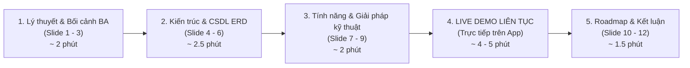
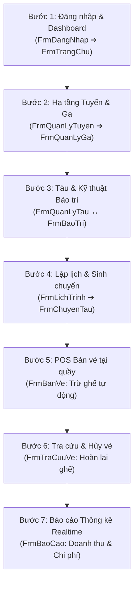

# KỊCH BẢN THUYẾT TRÌNH VÀ HƯỚNG DẪN LIVE DEMO LIÊN TỤC
## ĐỀ TÀI: HỆ THỐNG QUẢN LÝ TÀU ĐIỆN ĐÔ THỊ (SUBWAY MANAGEMENT SYSTEM)

> **Mục đích:** Tài liệu dành cho các thành viên trong nhóm trực tiếp cầm theo để tham khảo khi thuyết trình và thực hành demo trước Hội đồng.  
> **Đặc điểm kịch bản:**  
> - **Mạch trình bày 1 chiều xuyên suốt (Linear Flow):** Trình bày toàn bộ lý thuyết, BA, kiến trúc 3 tầng, CSDL ERD, tính năng và giải pháp kỹ thuật trên Slide ➔ Sau đó chuyển hẳn sang ứng dụng thực tế để **Live Demo 1 mạch liên tục từ A đến Z** ➔ Cuối cùng quay lại kết luận và Q&A.  
> - **Không phân vai cứng nhắc:** Văn bản viết trung tính dưới dạng `[Diễn giả thuyết trình]`, nhóm có thể linh hoạt phân đoạn bất kỳ ai nói phần nào mà không làm đứt gãy luồng trình bày.  
> - **Live Demo tối ưu:** Từng thao tác click chuột, chọn giá trị mẫu và thông báo đều được chỉ dẫn chi tiết, tránh hoàn toàn rủi ro thao tác sai khi demo.

---

## ⏱️ DÀN Ý TIẾN TRÌNH THỜI GIAN (TỔNG: 10 - 12 PHÚT)

---

## 🎙️ KỊCH BẢN THUYẾT TRÌNH CHI TIẾT THEO MẠCH XUYÊN SUỐT

---

### PHẦN 1: MỞ ĐẦU & BỐI CẢNH BÀI TOÁN NGHIỆP VỤ (SLIDE 1 - 3)

**[Diễn giả thuyết trình]:**
> *"Kính chào quý Thầy/Cô trong Hội đồng và các bạn sinh viên có mặt trong buổi báo cáo hôm nay.*  
> *Đại diện cho nhóm, em xin trân trọng giới thiệu đề tài tốt nghiệp/báo cáo học phần: **Hệ thống Quản lý Tàu điện Đô thị (Subway Management System)** - được xây dựng trên nền tảng **C# Windows Forms (.NET 4.7.2)** và hệ quản trị cơ sở dữ liệu **Microsoft SQL Server**.*  
>
> *Thưa Thầy/Cô, trong các đô thị phát triển như TP.HCM với tuyến Metro Bến Thành - Suối Tiên, hệ thống đường sắt đô thị giữ vai trò huyết mạch. Tuy nhiên, việc vận hành thực tế đối mặt với 3 thách thức lớn:*  
> *1. **Lịch trình chạy tàu:** Đòi hỏi độ chuẩn xác tuyệt đối đến từng phút, không được phép chồng chéo.*  
> *2. **An toàn kỹ thuật:** Mỗi đoàn tàu trước khi lăn bánh phải được kiểm định, bảo dưỡng nghiêm ngặt; mọi hỏng hóc phải cập nhật trạng thái tức thời.*  
> *3. **Áp lực quầy vé POS:** Vào các khung giờ cao điểm, lượng khách đổ về rất lớn, yêu cầu nhân viên phải xuất vé trong vài giây, tự động tính cước theo chặng và hỗ trợ chính sách miễn giảm linh hoạt.*  
>
> *Từ bài toán đó, nhóm chúng em đã phân tích và thiết kế hệ thống với **mô hình phân quyền 4 vai trò (RBAC)** rõ ràng:*  
> *- **Admin:** Toàn quyền quản trị danh mục, nhân sự và theo dõi báo cáo doanh thu.*  
> *- **Nhân viên Bán vé:** Sử dụng giao diện POS chuyên trách để bán vé, tra cứu và xử lý hủy vé.*  
> *- **Nhân viên Kỹ thuật:** Giám sát đoàn tàu, lập phiếu bảo dưỡng định kỳ.*  
> *- **Lái tàu:** Tra cứu lịch trình phân công công tác trên tuyến."*

---

### PHẦN 2: KIẾN TRÚC KỸ THUẬT & CƠ SỞ DỮ LIỆU (SLIDE 4 - 6)

**[Diễn giả thuyết trình]:**
> *"Để đáp ứng yêu cầu vận hành bền bỉ và bảo mật, hệ thống được thiết kế theo **Kiến trúc phân tầng 3-Tier** chuẩn mực:*  
> *- **Tầng Presentation:** Gồm 15 Forms Windows Forms được thiết kế trực quan, phân tách module độc lập và kiểm soát validation đầu vào nghiêm ngặt.*  
> *- **Tầng Business Logic & Data Access (DAL):** Được đóng gói tập trung trong module `Ketnoi_CSDL.cs`, thực thi truy vấn an toàn và loại bỏ 100% rủi ro SQL Injection thông qua cơ chế SqlParameter.*  
> *- **Tầng Database:** Vận hành trên Microsoft SQL Server với chuẩn hóa 3NF.*  
>
> *Kính mời quý Thầy/Cô quan sát trên màn hình, đây là **Lược đồ quan hệ thực thể (ERD)** hoàn chỉnh của hệ thống [Chỉ vào hình ảnh ERD trên Slide].*  
> *Cơ sở dữ liệu của chúng em được chuẩn hóa đạt chuẩn 3NF, gồm **11 bảng** được liên kết chặt chẽ và chia thành 5 khối nghiệp vụ chính:*  
>
> *1. **Khối Hạ tầng Tuyến & Nhà ga** (gồm 3 bảng: `Tuyen`, `Ga`, `Tuyen_Ga`):*  
> *- Bảng `Tuyen` và `Ga`: Bảng `Tuyen` xác định thông tin tuyến metro và có 2 khóa ngoại liên kết trực tiếp về ga đầu (`MaGaDau`) và ga cuối (`MaGaCuoi`) trong bảng `Ga`.*  
> *- Bảng trung gian `Tuyen_Ga`: Giải quyết quan hệ nhiều - nhiều giữa Tuyến và Ga, lưu trữ thứ tự đón/trả khách (`ThuTu`) và thời gian tàu dừng đỗ (`PhutDung`) tại từng nhà ga.*  
>
> *2. **Khối Phương tiện & Kỹ thuật Bảo trì** (gồm 3 bảng: `Tau`, `ToaTau`, `BaoTri`):*  
> *- Bảng `Tau`: Quản lý các đoàn tàu, sức chứa và được gán trực tiếp chạy trên tuyến nào thông qua khóa ngoại `MaTuyen`.*  
> *- Bảng `ToaTau`: Quản lý chi tiết từng toa theo số thứ tự (`SoThuTu`), loại toa và sức chứa.*  
> *- Bảng `BaoTri`: Ghi nhận lịch sử bảo dưỡng kỹ thuật của tàu từ ngày bắt đầu đến kết thúc (`NgayBatDau`, `NgayKetThuc`), nội dung bảo trì, kinh phí (`ChiPhi`) và trạng thái an toàn.*  
>
> *3. **Khối Vận hành Lịch trình & Chuyến tàu** (gồm 2 bảng: `LichTrinh`, `ChuyenTau`):*  
> *- Bảng `LichTrinh`: Thiết lập khung giờ chạy cố định (`GioDi`, `GioDen`) theo các thứ trong tuần (`ThuTrongTuan`) cho từng đoàn tàu trên từng tuyến.*  
> *- Bảng `ChuyenTau`: Được sinh ra từ lịch trình (`sinh ra chuyen`), biểu diễn chuyến tàu vận hành thực tế trong ngày (`NgayChay`).*  
>
> *4. **Khối Quản trị Nhân sự & Phân công Vận hành** (bảng `NhanVien`):*  
> *- Bảng `NhanVien`: Đóng vai trò hạt nhân trong quản lý người dùng (tài khoản, mật khẩu, chức vụ) và phân định trách nhiệm.*  
> *- Điểm đắt giá trên sơ đồ ERD là `NhanVien` liên kết trực tiếp vào 3 quy trình vận hành then chốt:*  
>   *+ Nhân viên kỹ thuật thực hiện bảo trì tàu (`thuc hien (KyThuat)` qua `MaNV` trong bảng `BaoTri`).*  
>   *+ Nhân viên lái tàu được phân công điều khiển chuyến thực tế (`lai (LaiTau)` qua `MaLaiTau` trong bảng `ChuyenTau`).*  
>   *+ Nhân viên thu ngân trực tiếp bán vé cho khách (`ban ve` qua `MaNVBan` trong bảng `Ve`).*  
>
> *5. **Khối Thương mại Bán vé & Hành khách** (gồm 2 bảng: `HanhKhach`, `Ve`):*  
> *- Bảng `HanhKhach`: Quản lý hồ sơ định danh của khách hàng (Họ tên, CCCD, Điện thoại).*  
> *- Bảng `Ve`: Là trung tâm của giao dịch POS, liên kết đa chiều:*  
>   *Vé thuộc về chuyến tàu nào (`MaChuyen`), ai mua (`MaHK`), đi từ ga nào đến ga nào (`MaGaDi`, `MaGaDen` trỏ về bảng `Ga`), nhân viên nào bán (`MaNVBan`), cùng giá vé và ngày mua thời gian thực.*  
>
> *Nhờ cấu trúc liên kết toàn vẹn này, cơ sở dữ liệu đảm bảo không xảy ra dư thừa dữ liệu, đồng thời truy vết được dòng tiền và trách nhiệm vận hành của từng bộ phận một cách tuyệt đối minh bạch.*  
>
> *Đặc biệt, hệ thống khai thác sức mạnh của **5 Stored Procedures cốt lõi**: `sp_DangNhap` xác thực tài khoản phân quyền; `sp_SinhChuyen` tự động sinh các chuyến tàu hàng ngày chống trùng lặp; `sp_BaoCaoDoanhThu`, `sp_DoanhThuTheoTuyen` và `sp_ChiPhiBaoTri` hỗ trợ thống kê tài chính thời gian thực."*

---

### PHẦN 3: TỔNG QUAN TÍNH NĂNG & ĐIỂM SÁNG KỸ THUẬT (SLIDE 7 - 9)

**[Diễn giả thuyết trình]:**
> *"Hệ thống bao quát toàn diện quy trình vận hành thông qua **15 màn hình chức năng** được chia thành 6 phân hệ nghiệp vụ: Quản trị, Hạ tầng, Phương tiện, Lịch trình, Bán vé POS và Báo cáo tài chính.*  
>
> *Trong quá trình hiện thực hóa dự án, nhóm đã giải quyết được các bài toán kỹ thuật trọng điểm:*  
> *1. **Đảm bảo toàn vẹn giao dịch (ACID Transactions):** Khi hành khách mua vé hoặc hủy vé, hệ thống vừa thực hiện ghi nhận bản ghi vé, vừa cập nhật giảm/tăng số lượng ghế trống trên chuyến tàu tương ứng. Nếu một trong hai thao tác thất bại, hệ thống tự động Rollback.*  
> *2. **Bảo mật truy vấn:** 100% câu lệnh SQL đều sử dụng tham số hóa, phòng chống tấn công SQL Injection.*  
> *3. **Tối ưu giao diện WinForms:** Nhóm đã xử lý triệt để xung đột layout WinForms giữa cơ chế `AutoSizeColumnsMode = Fill` và việc thiết lập độ rộng cột `.Width` trên các TabPage ẩn, giúp 15 màn hình hiển thị mượt mà không xảy ra lỗi NullReference.*  
> *4. **Chuẩn hóa Unicode UTF-8:** Hỗ trợ hiển thị tiếng Việt có dấu hoàn hảo trên toàn bộ cơ sở dữ liệu và giao diện người dùng.*  
>
> *Và ngay sau đây, để Thầy/Cô có cái nhìn chân thực nhất về hoạt động của phần mềm, nhóm chúng em xin phép chuyển sang phần **LIVE DEMO TRỰC TIẾP TOÀN BỘ HỆ THỐNG** theo một mạch vận hành nghiệp vụ thực tế khép kín."*

---

### PHẦN 4: KỊCH BẢN LIVE DEMO LIÊN TỤC 1 MẠCH (TRỰC TIẾP TRÊN PHẦN MỀM)

> **Hướng dẫn kỹ thuật:** Diễn giả chuyển màn hình từ PowerPoint sang Visual Studio / Ứng dụng đã chạy sẵn. Thực hiện tuần tự 7 bước liên tục không ngắt quãng.

#### Bước 1: Đăng nhập & Dashboard Quản trị
* **Thao tác:** Mở `FrmDangNhap` ➔ Nhập tài khoản `admin`, mật khẩu `123456` ➔ Bấm **Đăng nhập**.
* **Lời nói:**  
  > *"Trước tiên, em đăng nhập bằng tài khoản Quản trị viên (`admin`). Giao diện Trang chủ `FrmTrangChu` mở ra với các khối số liệu thống kê tổng quan: số tuyến đang mở, số đoàn tàu sẵn sàng vận hành và doanh thu trong ngày."*

#### Bước 2: Kiểm tra Hạ tầng Tuyến và Nhà ga
* **Thao tác:** Nhấp Menu **Quản lý Tuyến** (`FrmQuanLyTuyen`) ➔ Chọn Tuyến 1 (`Bến Thành - Suối Tiên`) ➔ Mở **Chi tiết tuyến** (`FrmChiTietTuyen`).
* **Lời nói:**  
  > *"Ở phân hệ Hạ tầng, hệ thống quản lý danh sách tuyến và các chặng dừng. Tuyến số 1 có các nhà ga từ Bến Thành, Nhà hát TP, Ba Son... được sắp xếp thứ tự và tính khoảng cách chuẩn xác để làm căn cứ tính cước vé sau này."*

#### Bước 3: Quản lý Phương tiện & Đồng bộ Bảo dưỡng kỹ thuật
* **Thao tác:** Mở **Quản lý Tàu** (`FrmQuanLyTau`) ➔ Thấy tàu `SE01` đang ở trạng thái `Sẵn sàng`.  
  Mở tiếp **Quản lý Bảo trì** (`FrmBaoTri`) ➔ Tạo một phiếu bảo trì mới cho tàu `SE01`, chọn trạng thái `Đang bảo dưỡng` ➔ Lưu lại.  
  Quay lại `FrmQuanLyTau` bấm **Làm mới**.
* **Lời nói:**  
  > *"Tiếp theo là phân hệ kỹ thuật: Tàu `SE01` ban đầu sẵn sàng chạy. Khi đội ngũ kỹ thuật lập phiếu bảo dưỡng định kỳ trên `FrmBaoTri`, trạng thái của tàu trên `FrmQuanLyTau` lập tức được đồng bộ sang 'Đang bảo dưỡng'. Nhờ đó, điều độ viên sẽ không thể vô ý xếp một đoàn tàu đang bảo trì vào lịch chạy, đảm bảo an toàn tuyệt đối."*

#### Bước 4: Lập Lịch trình & Tự động sinh Chuyến tàu trong ngày
* **Thao tác:** Mở **Lịch trình** (`FrmLichTrinh`) ➔ Xem các khung giờ chạy định kỳ theo ngày trong tuần.  
  Mở **Chuyến tàu** (`FrmChuyenTau`) ➔ Bấm nút **Sinh chuyến** hoặc hiển thị danh sách các chuyến tàu thực tế hôm nay.
* **Lời nói:**  
  > *"Để giảm thiểu thao tác nhập liệu thủ công mỗi sáng, hệ thống có tính năng sinh chuyến tự động bằng Stored Procedure `sp_SinhChuyen`. Hệ thống tự động quét khung giờ lịch trình để tạo các chuyến chạy cụ thể trong ngày kèm số lượng ghế trống ban đầu."*

#### Bước 5: Điểm bán vé POS tại quầy (Smart Ticketing)
* **Thao tác:** Mở màn hình **Bán vé** (`FrmBanVe`):
  1. Chọn Tuyến 1.
  2. Chọn Ga đi: `Bến Thành`, Ga đến: `Suối Tiên`.
  3. Chọn Chuyến tàu còn ghế trống (ví dụ còn 200 ghế).
  4. Loại vé: `Vé thường`. Giá vé tự động tính toán lũy tiến theo số chặng ga.
  5. Nhập Họ tên khách hàng: `Nguyễn Văn An`, CCCD/SĐT.
  6. Bấm nút **Xuất vé**.
* **Lời nói:**  
  > *"Và đây là phân hệ trọng tâm: Điểm bán vé POS quầy `FrmBanVe`. Nhân viên thu ngân chỉ cần chọn tuyến, ga đi, ga đến. Hệ thống tự động tính cước chuẩn xác theo số ga di chuyển.  
  > Khi em bấm 'Xuất vé', mã vé mới được tạo lập tức, thông tin hành khách được lưu trữ, và quan trọng nhất: số ghế trống trên chuyến tàu lập tức bị trừ đi 1 ghế ngay trên lưới dữ liệu thời gian thực."*

#### Bước 6: Tra cứu & Xử lý Hủy vé (Hoàn ghế tự động)
* **Thao tác:** Mở **Tra cứu vé** (`FrmTraCuuVe`) ➔ Nhập mã vé vừa xuất hoặc tìm theo CCCD `Nguyễn Văn An`.  
  Bấm chọn vé đó ➔ Bấm nút **Hủy vé** ➔ Xác nhận hộp thoại cảnh báo.  
  Quay lại `FrmBanVe` hoặc `FrmChuyenTau` kiểm tra: Số ghế trống đã tự động tăng lại +1 ghế.
* **Lời nói:**  
  > *"Trong trường hợp khách hàng muốn đổi chuyến hoặc hủy vé, nhân viên mở `FrmTraCuuVe` tìm kiếm theo số CCCD. Khi bấm 'Hủy vé', trạng thái vé chuyển sang 'Đã hủy' và cơ chế Transaction trong cơ sở dữ liệu sẽ tự động cộng hoàn lại 1 ghế trống cho chuyến tàu để phục vụ khách hàng khác."*

#### Bước 7: Báo cáo Thống kê & Bảng điều khiển Tài chính
* **Thao tác:** Mở màn hình **Báo cáo** (`FrmBaoCao`):
  - Chuyển tab **Doanh thu theo ngày**: Hiển thị tổng tiền bán vé và số vé bán ra.
  - Chuyển tab **Doanh thu theo tuyến**: Hiển thị tỷ trọng tuyến nào đông khách nhất.
  - Chuyển tab **Chi phí bảo trì**: Hiển thị chi phí bảo dưỡng từng tàu.
* **Lời nói:**  
  > *"Cuối cùng, màn hình Báo cáo `FrmBaoCao` cung cấp cái nhìn tài chính toàn diện cho ban giám đốc: Thống kê doanh thu theo ngày, lưu lượng khách trên từng tuyến và chi phí kỹ thuật. Màn hình hoạt động nhanh chóng, chính xác và không có bất kỳ độ trễ nào."*

---

### PHẦN 5: ĐÁNH GIÁ KẾT QUẢ, ĐỊNH HƯỚNG PHÁT TRIỂN & KẾT LUẬN (SLIDE 10 - 12)

> **Hướng dẫn kỹ thuật:** Diễn giả chuyển màn hình quay lại PowerPoint Slide 10.

**[Diễn giả thuyết trình]:**
> *"Kính thưa Thầy/Cô, qua phần trình diễn vừa rồi, phần mềm đã chứng minh năng lực đáp ứng trọn vẹn mọi yêu cầu nghiệp vụ thực tế của một hệ thống quản lý đường sắt đô thị.*  
>
> *Về mặt hiệu năng, phần mềm giúp:*  
> *- Rút ngắn thời gian phục vụ tại quầy vé xuống dưới 15 giây/khách.*  
> *- Ngăn chặn 100% lỗi xung đột điều phối đoàn tàu.*  
> *- Minh bạch hóa toàn bộ dữ liệu tài chính và kỹ thuật.*  
>
> *Trong các giai đoạn tiếp theo (Roadmap), nhóm định hướng mở rộng thêm:*  
> *1. **Cổng soát vé tự động:** Tích hợp đầu đọc QR Code động trên màn hình điện thoại và thẻ thông minh RFID/NFC tại cổng ra vào.*  
> *2. **App di động cho hành khách:** Cho phép người dân mua vé trực tuyến và xem vị trí tàu chạy thời gian thực.*  
> *3. **Hệ thống cảm biến IoT:** Theo dõi tình trạng kỹ thuật bánh tàu, nhiệt độ động cơ để dự đoán bảo trì tự động.*  
>
> *Đề tài của nhóm chúng em đến đây là kết thúc. Chúng em xin chân thành cảm ơn quý Thầy/Cô trong Hội đồng đã chú ý lắng nghe và rất mong nhận được những góp ý quý báu từ Thầy/Cô! Nhóm chúng em sẵn sàng bước vào phần giải đáp câu hỏi ạ!"*

---

## 🛡️ PHẦN 6: BỘ 6 CÂU HỎI VẤN ĐÁP PHẢN BIỆN (Q&A DEFENSE)

### Câu 1: Làm thế nào hệ thống ngăn chặn việc 2 quầy bán vé cùng đặt trùng 1 chỗ ngồi (Concurrency Concurrency Control)?
* **Trả lời chuẩn:**  
  > *"Thưa Thầy/Cô, trong cơ chế bán vé của hệ thống, thao tác xuất vé và trừ ghế trống được thực thi trong một Transaction duy nhất ở mức độ cách ly thích hợp. Khi nhân viên quầy 1 bấm xuất vé, bản ghi chuyến tàu được cập nhật có điều kiện: `UPDATE ChuyenTau SET SoGheTrong = SoGheTrong - 1 WHERE MaChuyen = @MaChuyen AND SoGheTrong > 0`. Nếu số ghế đã hết tại thời điểm ghi nhận, câu lệnh sẽ tác động 0 dòng và hệ thống lập tức thông báo hết vé, ngăn chặn tình trạng bán âm hoặc trùng vé."*

### Câu 2: Tại sao nhóm lựa chọn xử lý nghiệp vụ sinh chuyến bằng Stored Procedure mà không viết bằng mã C#?
* **Trả lời chuẩn:**  
  > *"Thưa Thầy/Cô, nghiệp vụ sinh chuyến định kỳ đòi hỏi đọc toàn bộ lịch trình tuần và kiểm tra xem ngày hôm đó đã tồn tại chuyến chưa trước khi INSERT hàng loạt bản ghi mới. Nếu xử lý ở C#, ứng dụng phải thực hiện nhiều lượt gửi nhận dữ liệu (Network Round-trips) giữa ứng dụng và máy chủ CSDL. Việc đóng gói vào Stored Procedure `sp_SinhChuyen` giúp thực thi trực tiếp trên máy chủ SQL Server, tốc độ tăng gấp nhiều lần và giảm tải tối đa cho đường truyền mạng."*

### Câu 3: Mật khẩu người dùng trong cơ sở dữ liệu đang lưu trữ ra sao? Nếu triển khai thực tế nhóm sẽ bảo mật thế nào?
* **Trả lời chuẩn:**  
  > *"Thưa Thầy/Cô, trong phiên bản thử nghiệm học phần để tiện kiểm thử, hệ thống lưu mật khẩu dạng chuỗi. Tuy nhiên, theo đúng chuẩn bảo mật phần mềm, khi đưa vào môi trường Production thực tế, nhóm sẽ áp dụng cơ chế băm mật khẩu bằng thuật toán một chiều như BCrypt hoặc PBKDF2 kèm chuỗi ngẫu nhiên (Salt), đảm bảo ngay cả quản trị viên quản lý CSDL cũng không thể giải mã được mật khẩu của nhân viên."*

### Câu 4: Khi xóa một tuyến tàu hoặc một đoàn tàu có phát sinh lỗi khóa ngoại (Foreign Key) không? Nhóm xử lý thế nào?
* **Trả lời chuẩn:**  
  > *"Thưa Thầy/Cô, trong CSDL của nhóm, bảng `TuyenTau` có liên kết khóa ngoại với `ChiTietTuyen` và `LichTrinh`. Nhóm thiết lập ràng buộc toàn vẹn: không cho phép xóa cứng (Hard Delete) các tuyến tàu hay đầu tàu đã có lịch sử vận hành, chuyến tàu hoặc vé bán, nhằm tránh làm mất dữ liệu tài chính lịch sử. Thay vào đó, hệ thống áp dụng cơ chế xóa mềm (Soft Delete) bằng cách chuyển cột `TrangThai` sang 'Tạm ngưng' hoặc 'Ngừng hoạt động'."*

### Câu 5: Nhóm đã xử lý lỗi xung đột giao diện DataGridView trên các TabPage ẩn trong Form Báo cáo như thế nào?
* **Trả lời chuẩn:**  
  > *"Thưa Thầy/Cô, trong Windows Forms, khi DataGridView được đặt trong một TabPage chưa được người dùng nhấp chọn (chưa vẽ trên màn hình), việc thiết lập thuộc tính `AutoSizeColumnsMode = Fill` đồng thời can thiệp gán `.Width` thủ công cho từng cột sẽ gây ra ngoại lệ `NullReferenceException` tại hàm `set_Thickness` của .NET. Nhóm đã tối ưu bằng cách tắt chế độ tự động giãn cách `AutoSizeMode = None` trước khi thiết lập kích thước cột, đảm bảo toàn bộ dữ liệu tải ngầm mượt mà và không phát sinh lỗi."*

### Câu 6: Nếu hệ thống mở rộng kết nối với cổng xoay quét vé (Turnstile) ngoài thực tế thì cần tích hợp thêm gì?
* **Trả lời chuẩn:**  
  > *"Thưa Thầy/Cô, khi triển khai thực tế, bảng `Ve` sẽ bổ sung trường `MaVach_QR` dạng chuỗi mã hóa mã vé + thời gian xuất vé. Tại cổng xoay, nhóm chỉ cần tích hợp thêm module Web API giao tiếp qua TCP/IP hoặc REST API với bộ điều khiển cổng xoay (PLC/Controller). Khi hành khách quét vé, cổng gửi mã lên API để kiểm tra trạng thái vé `HopLe` và tuyến ga tương ứng, sau đó gửi tín hiệu mở chốt cổng và cập nhật vé sang trạng thái `DaSuDung`."*
