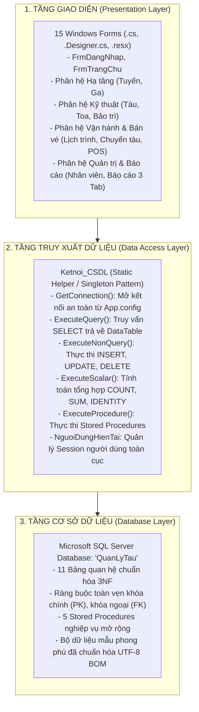
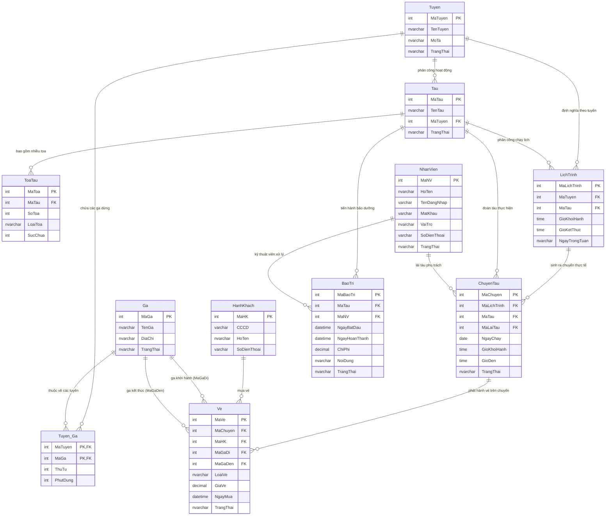
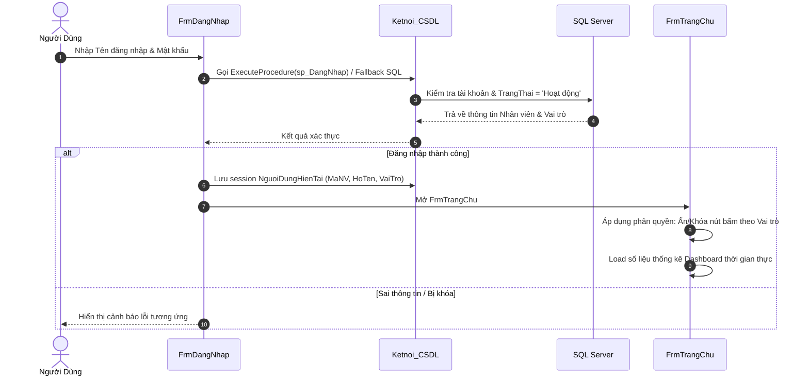
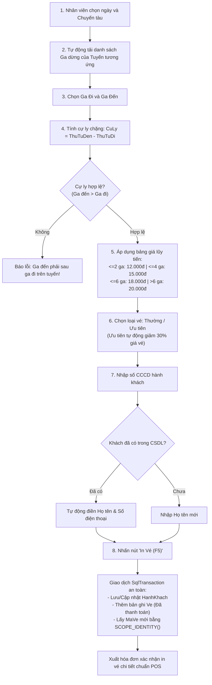
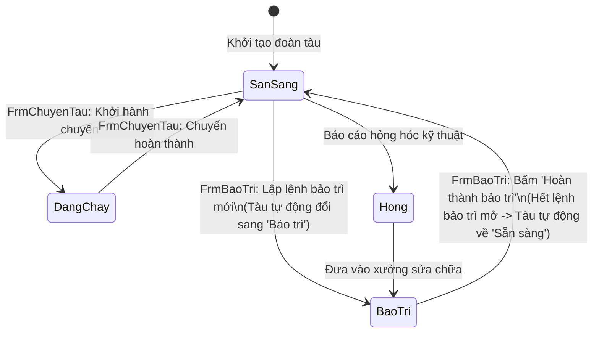

# TÀI LIỆU TỔNG HỢP TOÀN DIỆN HỆ THỐNG QUẢN LÝ TÀU ĐIỆN ĐÔ THỊ (SUBWAY MANAGEMENT SYSTEM)

> **Tài liệu phục vụ phân tích nghiệp vụ (BA), thiết kế kiến trúc phần mềm, thuyết trình dự án và nạp dữ liệu cho AI (NotebookLM & Gemini) tạo Slide tự động.**
> **Phiên bản:** 2.0 (Bản hoàn thiện & Đã kiểm thử toàn diện)  
> **Nền tảng:** C# Windows Forms (.NET Framework 4.7.2) | Microsoft SQL Server  
> **Kiến trúc:** Mô hình 3 tầng (Layered Architecture) | Phân quyền RBAC (Role-Based Access Control)

---

## MỤC LỤC
1. [TỔNG QUAN DỰ ÁN & MỤC TIÊU NGHIỆP VỤ](#1-tổng-quan-dự-án--mục-tiêu-nghiệp-vụ)
2. [KIẾN TRÚC KỸ THUẬT & CÔNG NGHỆ ÁP DỤNG](#2-kiến-trúc-kỹ-thuật--công-nghệ-áp-dụng)
3. [THIẾT KẾ CƠ SỞ DỮ LIỆU & LƯỢC ĐỒ QUAN HỆ (ERD)](#3-thiết-kế-cơ-sở-dữ-liệu--lược-đồ-quan-hệ-erd)
4. [HỆ THỐNG 5 STORED PROCEDURES MỞ RỘNG](#4-hệ-thống-5-stored-procedures-mở-rộng)
5. [CHI TIẾT 15 MÀN HÌNH (FORMS) & QUY TRÌNH NGHIỆP VỤ (WORKFLOWS)](#5-chi-tiết-15-màn-hình-forms--quy-trình-nghiệp-vụ-workflows)
6. [MA TRẬN PHÂN QUYỀN HỆ THỐNG (RBAC) & TÀI KHOẢN MẪU](#6-ma-trận-phân-quyền-hệ-thống-rbac--tài-khoản-mẫu)
7. [CÁC GIẢI PHÁP KỸ THUẬT NỔI BẬT & ĐIỂM SÁNG CÔNG NGHỆ](#7-các-giải-pháp-kỹ-thuật-nổi-bật--điểm-sáng-công-nghệ)
8. [ĐỊNH HƯỚNG PHÁT TRIỂN & CẢI TIẾN TRONG TƯƠNG LAI (ROADMAP)](#8-định-hướng-phát-triển--cải-tiến-trong-tương-lai-roadmap)

---

## 1. TỔNG QUAN DỰ ÁN & MỤC TIÊU NGHIỆP VỤ

### 1.1. Bối cảnh bài toán
Trong các đại đô thị hiện đại (như TP. Hồ Chí Minh với Tuyến Metro số 1 Bến Thành - Suối Tiên, hay Hà Nội với Cát Linh - Hà Đông), hệ thống đường sắt đô thị / tàu điện ngầm (Metro / Subway) đóng vai trò xương sống trong việc giải quyết ùn tắc giao thông, bảo vệ môi trường và phục vụ hàng trăm ngàn lượt hành khách mỗi ngày.

Để đảm bảo các chuyến tàu vận hành chính xác từng giây, an toàn kỹ thuật tuyệt đối và phục vụ bán vé tại quầy (POS) với thông lượng lớn, một hệ thống quản lý tập trung và tự động hóa là nhu cầu cấp thiết.

### 1.2. Mục tiêu dự án
* **Quản lý hạ tầng giao thông**: Chuẩn hóa danh mục tuyến tàu, hệ thống nhà ga dừng đỗ và thứ tự đón/trả khách trên từng tuyến.
* **Quản lý đội phương tiện & kỹ thuật**: Theo dõi chi tiết từng đoàn tàu, sức chứa các toa tàu, chu kỳ bảo dưỡng và tự động cập nhật trạng thái hoạt động.
* **Tự động hóa lịch trình & chuyến tàu**: Thiết lập lịch trình chạy theo khung giờ định kỳ trong tuần và cung cấp công cụ tự động sinh các chuyến tàu thực tế theo ngày (chống trùng lặp chuyến).
* **Điểm bán vé tại quầy (POS Smart Ticketing)**: Hỗ trợ nhân viên bán vé nhanh chóng, tự động tính cước lũy tiến theo số chặng ga dừng, áp dụng chính sách giảm giá ưu tiên và tra cứu nhanh lịch sử hành khách qua CCCD.
* **Phân quyền truy cập 4 vai trò (RBAC)**: Đảm bảo bảo mật và tách biệt chức năng giữa Quản lý, Bán vé, Kỹ thuật và Lái tàu.
* **Báo cáo thống kê & Dashboard quản trị**: Cung cấp bức tranh trực quan về doanh thu theo ngày, doanh thu tuyến, chi phí kỹ thuật thời gian thực phục vụ ra quyết định.

---

## 2. KIẾN TRÚC KỸ THUẬT & CÔNG NGHỆ ÁP DỤNG

### 2.1. Ngăn xếp công nghệ (Technology Stack)
* **Ngôn ngữ lập trình**: C# 7.3 (.NET Framework 4.7.2)
* **Giao diện người dùng**: Windows Forms (WinForms) với thiết kế phẳng (Flat Design Palette), tối ưu hóa trải nghiệm thao tác phím tắt và trực quan hóa số liệu.
* **Hệ quản trị CSDL**: Microsoft SQL Server (tương thích SQL Server Express, Developer, Enterprise).
* **Kết nối dữ liệu**: ADO.NET kết hợp mô hình Parameterized Queries & Stored Procedures (chống SQL Injection 100%).
* **Công cụ phát triển**: Visual Studio 2019 / 2022, SQL Server Management Studio (SSMS), Git Version Control.

### 2.2. Kiến trúc 3 tầng (3-Tier Architecture)

---

## 3. THIẾT KẾ CƠ SỞ DỮ LIỆU & LƯỢC ĐỒ QUAN HỆ (ERD)

Cơ sở dữ liệu **`QuanLyTau`** được thiết kế chuẩn hóa mức **3NF (Third Normal Form)**, triệt tiêu dư thừa dữ liệu và đảm bảo toàn vẹn tham chiếu với 11 bảng:

### 3.1. Danh mục 11 Bảng CSDL chi tiết

| STT | Tên Bảng | Khóa Chính (PK) | Khóa Ngoại (FK) | Chức năng lưu trữ & Ý nghĩa nghiệp vụ |
| :---: | :--- | :--- | :--- | :--- |
| **1** | **`NhanVien`** | `MaNV` (Identity) | Không | Danh sách cán bộ nhân viên, tài khoản, mật khẩu, vai trò (`QuanLy`, `BanVe`, `KyThuat`, `LaiTau`) và trạng thái làm việc. |
| **2** | **`Tuyen`** | `MaTuyen` (Identity) | Không | Danh mục tuyến tàu điện đô thị (hỗ trợ xóa mềm `TrangThai = 'Ngưng hoạt động'`). |
| **3** | **`Ga`** | `MaGa` (Identity) | Không | Danh mục nhà ga đón/trả khách, địa chỉ và trạng thái hoạt động. |
| **4** | **`Tuyen_Ga`** | `(MaTuyen, MaGa)` | `MaTuyen` -> `Tuyen` `MaGa` -> `Ga` | Lộ trình dừng đỗ của tuyến: Thứ tự dừng (`ThuTu`) và thời gian đỗ ga (`PhutDung`). |
| **5** | **`Tau`** | `MaTau` (Identity) | `MaTuyen` -> `Tuyen` | Danh sách đoàn tàu điện, tuyến phục vụ và trạng thái (`Sẵn sàng`, `Đang chạy`, `Bảo trì`, `Hỏng`). |
| **6** | **`ToaTau`** | `MaToa` (Identity) | `MaTau` -> `Tau` | Các toa tạo nên đoàn tàu: Số thứ tự toa, loại toa (`Thường`, `Ưu tiên`) và sức chứa hành khách. |
| **7** | **`LichTrinh`** | `MaLichTrinh` (Identity) | `MaTuyen` -> `Tuyen` `MaTau` -> `Tau` | Khung giờ vận hành định kỳ theo thứ trong tuần (`T2,T3,T4,T5,T6,T7,CN`). |
| **8** | **`ChuyenTau`** | `MaChuyen` (Identity) | `MaLichTrinh` -> `LichTrinh` `MaTau` -> `Tau` `MaLaiTau` -> `NhanVien` | Chuyến tàu vận hành thực tế theo ngày, gán lái tàu và trạng thái (`Chờ chạy`, `Đang chạy`, `Hoàn thành`, `Hủy`). |
| **9** | **`HanhKhach`** | `MaHK` (Identity) | Không | Hồ sơ hành khách định danh qua số CCCD/CMND (Unique), họ tên và số điện thoại. |
| **10** | **`Ve`** | `MaVe` (Identity) | `MaChuyen` -> `ChuyenTau` `MaHK` -> `HanhKhach` `MaGaDi` -> `Ga` `MaGaDen` -> `Ga` | Vé tàu đã phát hành: chuyến tàu, ga lên/xuống, loại vé, cước phí và trạng thái thanh toán. |
| **11** | **`BaoTri`** | `MaBaoTri` (Identity) | `MaTau` -> `Tau` `MaNV` -> `NhanVien` | Nhật ký bảo dưỡng kỹ thuật: ngày bắt đầu/kết thúc, chi phí, nội dung sửa chữa và kỹ thuật viên phụ trách. |

### 3.2. Sơ đồ thực thể liên kết (Entity Relationship Diagram - ERD)

---

## 4. HỆ THỐNG 5 STORED PROCEDURES MỞ RỘNG

Hệ thống được trang bị 5 Stored Procedures chuyên sâu giúp tăng tốc độ truy vấn, xử lý giao dịch an toàn và giảm thiểu lưu lượng mạng:

### 1. `sp_DangNhap` (@TenDangNhap, @MatKhau)
* **Mục đích**: Xác thực người dùng và kiểm tra điều kiện hoạt động.
* **Xử lý**: Lọc đúng tài khoản, mật khẩu và trạng thái `TrangThai = N'Hoạt động'`.

### 2. `sp_ThongKeTrangChu` ()
* **Mục đích**: Cung cấp số liệu thống kê thời gian thực cho Dashboard Trang chủ trong 1 câu gọi duy nhất.
* **Kết quả trả về**:
  - `SoTauSanSang`: Số tàu có trạng thái "Sẵn sàng".
  - `TongTau`: Tổng số đoàn tàu trong hệ thống.
  - `SoChuyenHomNay`: Số chuyến tàu lên lịch chạy trong ngày hiện tại.
  - `SoVeBanHomNay`: Tổng số vé đã bán thành công trong ngày hôm nay.
  - `DoanhThuHomNay`: Tổng doanh thu từ các vé hợp lệ trong ngày.

### 3. `sp_SinhChuyen` (@NgayChay, @MaLichTrinh, @MaTau, @MaLaiTau)
* **Mục đích**: Tự động sinh chuyến tàu thực tế từ cấu hình lịch trình định kỳ.
* **Xử lý**: Lấy giờ khởi hành, giờ kết thúc và mã tàu từ bảng `LichTrinh` để chèn vào `ChuyenTau` với trạng thái ban đầu là `Chờ chạy`.

### 4. `sp_BanVe` (@MaChuyen, @CCCD, @HoTen, @SoDienThoai, @MaGaDi, @MaGaDen, @LoaiVe, @GiaVe)
* **Mục đích**: Thực thi quy trình bán vé tại quầy đảm bảo tính nguyên tố (Atomic Transaction).
* **Xử lý**: 
  - Tự động kiểm tra CCCD: Nếu khách đã tồn tại thì cập nhật lại thông tin mới; nếu chưa thì tạo mới hành khách.
  - Tạo vé mới trong bảng `Ve` với trạng thái `Đã thanh toán`.
  - Trả về mã vé mới vừa sinh (`MaVeMoi`).

### 5. `sp_HuyVe` (@MaVe)
* **Mục đích**: Hủy vé tàu an toàn theo yêu cầu của hành khách.
* **Xử lý**: Cập nhật trạng thái vé sang `Đã hủy`, phục vụ công tác đối soát kế toán.

---

## 5. CHI TIẾT 15 MÀN HÌNH (FORMS) & QUY TRÌNH NGHIỆP VỤ (WORKFLOWS)

### 5.1. Bảng chi tiết 15 Màn hình (Forms)

| STT | Tên Form | Đối tượng | Mô tả chức năng & Nghiệp vụ chi tiết |
| :---: | :--- | :---: | :--- |
| **1** | **FrmDangNhap** | Tất cả | Xác thực tài khoản nhân viên qua `sp_DangNhap` (hoặc truy vấn an toàn). Kiểm tra mật khẩu, trạng thái tài khoản. Khởi tạo phiên làm việc `NguoiDungHienTai` và điều hướng sang Trang chủ. Hỗ trợ phím Enter thuận tiện. |
| **2** | **FrmTrangChu** | Tất cả | **Dashboard trung tâm**: Hiển thị 4 thẻ số liệu trực quan: Tàu sẵn sàng, Chuyến hôm nay, Vé bán hôm nay, Doanh thu hôm nay. Menu điều hướng thông minh: Tự động vô hiệu hóa và đổi màu các nút bấm ngoài phạm vi phân quyền của vai trò đăng nhập. |
| **3** | **FrmQuanLyTuyen** | Quản lý | Quản lý danh mục tuyến tàu đô thị. Hỗ trợ CRUD, tìm kiếm theo từ khóa. Áp dụng xóa mềm (Soft-Delete) chuyển trạng thái `Ngưng hoạt động` để bảo toàn lịch sử dữ liệu. Nút truy cập nhanh cấu hình chi tiết ga của tuyến. |
| **4** | **FrmChiTietTuyen** | Quản lý | Cấu hình chi tiết lộ trình tuyến (`Tuyen_Ga`). Thêm ga vào tuyến, xóa ga, điều chỉnh thứ tự đón khách (`ThuTu`) và thời gian dừng đỗ (`PhutDung`). Tự động đánh số thứ tự liên tục khi có thay đổi. |
| **5** | **FrmQuanLyGa** | Quản lý | Danh mục nhà ga đô thị. Thêm mới, cập nhật thông tin ga. **Ràng buộc nghiệp vụ quan trọng**: Chặn ngưng hoạt động ga nếu nhà ga đó đang nằm trên tuyến tàu đang hoạt động. |
| **6** | **FrmQuanLyTau** | Quản lý, Kỹ thuật | Quản lý đoàn tàu điện. Hiển thị tuyến hoạt động, trạng thái tàu, số toa và **tổng sức chứa khách** (tính toán động từ bảng `ToaTau`). Lọc danh sách theo trạng thái (`Sẵn sàng`, `Đang chạy`, `Bảo trì`, `Hỏng`) hoặc theo tuyến. |
| **7** | **FrmChiTietTau** | Quản lý, Kỹ thuật | Quản lý các toa của đoàn tàu. Thêm toa mới, chỉnh sửa loại toa (`Thường`, `Ưu tiên`), cập nhật sức chứa từng toa. Hiển thị tổng số toa và tổng chỗ ngồi của đoàn tàu. |
| **8** | **FrmBaoTri** | Quản lý, Kỹ thuật | Quản lý bảo dưỡng sửa chữa. Tạo lệnh bảo trì mới ➔ **Đoàn tàu tự động chuyển sang trạng thái 'Bảo trì'**. Cập nhật chi phí, nội dung. Nút 'Hoàn thành' ➔ Ghi nhận ngày hoàn thành, kiểm tra hết lệnh mở ➔ **Đoàn tàu tự động phục hồi về trạng thái 'Sẵn sàng'**. |
| **9** | **FrmLichTrinh** | Quản lý | Cấu hình lịch vận hành định kỳ theo tuyến, tàu, giờ đi/đến và chọn các ngày trong tuần (`T2..CN`). **Công cụ sinh chuyến**: Tự động duyệt lịch và sinh các chuyến tàu tương ứng vào bảng `ChuyenTau` cho bất kỳ ngày nào được chọn, chống trùng lặp. |
| **10** | **FrmChuyenTau** | Quản lý, Bán vé, Lái tàu | Quản lý danh sách chuyến tàu chạy theo từng ngày. Phân công nhân viên lái tàu. Cập nhật chuyển đổi trạng thái chuyến: `Chờ chạy` ➔ `Đang chạy` ➔ `Hoàn thành` / `Hủy`. **Chế độ Lái tàu**: Tự động lọc chỉ hiển thị các chuyến được phân công cho chính lái tàu đó. |
| **11** | **FrmBanVe** | Quản lý, Bán vé | **Điểm bán vé quầy POS**: Chọn chuyến theo ngày, chọn ga đi/đến. Tự động tính chặng di chuyển và đơn giá vé. Giảm giá 30% cho vé ưu tiên. Tự động tra cứu khách hàng qua CCCD, tự tạo khách mới trong giao dịch SQL an toàn (Transaction). Xuất phiếu vé xác nhận chuẩn POS. |
| **12** | **FrmTraCuuVe** | Quản lý, Bán vé | Tra cứu vé đã phát hành theo Mã vé, số CCCD hành khách hoặc theo khoảng thời gian mua vé. Xem chi tiết thông tin hành trình. Hỗ trợ hủy vé chưa sử dụng với hộp thoại xác nhận an toàn. |
| **13** | **FrmHanhKhach** | Quản lý, Bán vé | Quản lý khách hàng thân thiết. Tìm kiếm theo họ tên, CCCD, số điện thoại. Hiển thị tổng số vé đã mua và tổng chi tiêu. Mô hình **Master-Detail**: Nhấp chọn hành khách để xem ngay lưới toàn bộ lịch sử các vé đã mua. |
| **14** | **FrmNhanVien** | Quản lý | Quản lý danh sách nhân sự và tài khoản hệ thống. Thêm nhân viên, gán vai trò (`QuanLy`, `BanVe`, `KyThuat`, `LaiTau`), kiểm tra chống trùng lặp username. Hỗ trợ cập nhật thông tin, trạng thái hoạt động và đặt lại mật khẩu mặc định (`123456`). Chặn admin tự khóa chính mình. |
| **15** | **FrmBaoCao** | Quản lý | Hệ thống báo cáo thống kê chuyên sâu gồm 3 Tab: • **Tab 1**: Thống kê doanh thu, số vé bán, vé hủy theo khoảng ngày/tháng kèm bảng chi tiết từng ngày. • **Tab 2**: Doanh thu lũy kế theo từng tuyến tàu, số chuyến và sản lượng vé. • **Tab 3**: Báo cáo tổng hợp số lượt bảo trì, tổng chi phí kỹ thuật theo khoảng ngày hoặc theo từng đoàn tàu. |

---

### 5.2. Các quy trình nghiệp vụ cốt lõi (Workflows)

#### Quy trình 1: Xác thực & Điều hướng Trang chủ phân quyền

#### Quy trình 2: Bán vé quầy POS & Tính cước tự động theo cự ly

#### Quy trình 3: Vòng đời bảo trì & Đồng bộ trạng thái đoàn tàu

---

## 6. MA TRẬN PHÂN QUYỀN HỆ THỐNG (RBAC) & TÀI KHOẢN MẪU

### 6.1. Bảng ma trận phân quyền theo vai trò

| Chức năng / Màn hình | Quản Lý (`QuanLy`) | Bán Vé (`BanVe`) | Kỹ Thuật (`KyThuat`) | Lái Tàu (`LaiTau`) |
| :--- | :---: | :---: | :---: | :---: |
| **Đăng nhập & Trang chủ Dashboard** | ✔ | ✔ | ✔ | ✔ |
| **Quản lý Tuyến & Chi tiết Ga dừng** | ✔ | ✖ | ✖ | ✖ |
| **Quản lý Danh mục Ga tàu** | ✔ | ✖ | ✖ | ✖ |
| **Quản lý Tàu điện & Chi tiết Toa** | ✔ | ✖ | ✔ | ✖ |
| **Lập & Hoàn thành Phiếu bảo trì** | ✔ | ✖ | ✔ | ✖ |
| **Cấu hình Lịch trình & Sinh chuyến** | ✔ | ✖ | ✖ | ✖ |
| **Quản lý Chuyến tàu** | ✔ | ✔ (Xem) | ✖ | ✔ (Chuyến phân công) |
| **Bán vé tại quầy (POS)** | ✔ | ✔ | ✖ | ✖ |
| **Tra cứu & Hủy vé** | ✔ | ✔ | ✖ | ✖ |
| **Quản lý Hành khách & Lịch sử đi tàu** | ✔ | ✔ | ✖ | ✖ |
| **Quản lý Nhân viên & Phân quyền** | ✔ | ✖ | ✖ | ✖ |
| **Báo cáo Thống kê Doanh thu & Kỹ thuật** | ✔ | ✖ | ✖ | ✖ |

### 6.2. Danh sách 4 Tài khoản thử nghiệm có sẵn trong CSDL

| Tài khoản | Mật khẩu | Vai trò | Quyền hạn khi đăng nhập |
| :---: | :---: | :---: | :--- |
| **admin** | `123456` | **Quản Lý** (`QuanLy`) | Toàn quyền sử dụng tất cả 15 màn hình giao diện. |
| **banve** | `123456` | **Bán Vé** (`BanVe`) | Sử dụng các màn hình: Trang chủ, Chuyến tàu (xem), Bán vé POS, Tra cứu & Hủy vé, Hành khách. |
| **kythuat** | `123456` | **Kỹ Thuật** (`KyThuat`) | Sử dụng các màn hình: Trang chủ, Quản lý tàu, Chi tiết toa tàu, Quản lý bảo trì. |
| **laixe** | `123456` | **Lái Tàu** (`LaiTau`) | Sử dụng màn hình Trang chủ và xem danh sách các chuyến tàu được phân công cho chính mình. |

---

## 7. CÁC GIẢI PHÁP KỸ THUẬT NỔI BẬT & ĐIỂM SÁNG CÔNG NGHỆ

### 1. Triệt tiêu 100% lỗ hổng SQL Injection
Toàn bộ tầng `Ketnoi_CSDL` và các Form đều sử dụng câu lệnh truy vấn có tham số (`SqlParameter`) hoặc Stored Procedures. Không bao giờ cộng chuỗi SQL trực tiếp, ngăn chặn tuyệt đối các kỹ thuật tấn công SQL Injection.

### 2. Tính toàn vẹn dữ liệu giao dịch (ACID Transaction)
Chức năng Bán vé quầy POS áp dụng cơ chế `SqlTransaction`. Nếu quá trình lưu thông tin hành khách hoặc phát hành vé gặp lỗi, toàn bộ giao dịch được tự động Rollback, đảm bảo không bao giờ phát sinh dữ liệu rác trong CSDL.

### 3. Chuẩn hóa mã hóa ký tự tiếng Việt (UTF-8 BOM)
Các tệp script CSDL (`QuanLyTau.sql` và `BoSung_StoredProcedures.sql`) được chuẩn hóa với bảng mã **UTF-8 with BOM**. Điều này khắc phục triệt để hiện tượng vỡ font tiếng Việt (mojibake) khi người dùng mở và thực thi script trong các phiên bản SSMS sử dụng bảng mã ANSI/Windows-1252.

### 4. Cơ chế Fallback tự động 2 lớp
Trong các Form nghiệp vụ (như Đăng nhập, Bán vé, Hủy vé, Dashboard), hệ thống ưu tiên gọi các Stored Procedures để đạt hiệu năng tối đa. Nếu CSDL chưa được nạp Stored Procedures, hệ thống tự động chuyển sang câu lệnh SQL tham số tương đương mà không làm gián đoạn trải nghiệm người dùng.

### 5. Khắc phục triệt để lỗi Layout DataGridView trong WinForms TabControl
Xử lý lỗi `NullReferenceException` tại `DataGridViewBand.set_Thickness` bằng cách gán `AutoSizeMode = DataGridViewAutoSizeColumnMode.None` trước khi đặt độ rộng cột (`.Width`) cho các DataGridView nằm trong các Tab chưa được vẽ Handle đồ họa, đảm bảo 15/15 Form hoạt động mượt mà trên mọi máy tính và độ phân giải màn hình.

---

## 8. ĐỊNH HƯỚNG PHÁT TRIỂN & CẢI TIẾN TRONG TƯƠNG LAI (ROADMAP)

Dưới đây là các định hướng mở rộng mang tính thực tiễn cao dành cho hệ thống khi bước vào môi trường sản xuất công nghiệp:

### 1. Nâng cấp an toàn thông tin (Security & Cryptography)
* Áp dụng mã hóa mật khẩu một chiều sử dụng thuật toán **BCrypt** hoặc **PBKDF2/SHA-256 kèm Salt**.
* Cơ chế khóa tài khoản tạm thời khi đăng nhập sai quá 5 lần liên tiếp.

### 2. Hệ thống Soát vé tự động (AFC - Automatic Fare Collection)
* Tích hợp tạo mã **QR Code động** in trực tiếp lên vé tàu hoặc hiển thị trên ứng dụng.
* Hỗ trợ chuẩn thẻ thông minh không tiếp xúc (**NFC / RFID Mifare Card**) phục vụ vé tháng và vé năm cho người dân đô thị.

### 3. Mở rộng kiến trúc Đa nền tảng (Mobile & Web API)
* Xây dựng tầng dịch vụ **ASP.NET Core Web API** đóng vai trò Backend tập trung.
* Phát triển ứng dụng di động (**Mobile App - Flutter / React Native**) cho phép hành khách:
  - Tra cứu chuyến tàu và thời gian tàu đến ga theo thời gian thực (Real-time Arrival).
  - Mua vé và thanh toán trực tuyến qua các cổng thanh toán điện tử (**VNPAY, MoMo, VietQR, ZaloPay**).

### 4. Báo cáo & Trí tuệ doanh nghiệp (BI & Big Data)
* Tích hợp thư viện xuất dữ liệu báo cáo chuyên nghiệp sang định dạng **Excel (.xlsx)** và **PDF**.
* Thuật toán phân tích lưu lượng hành khách theo khung giờ cao điểm để tự động đề xuất tăng/giảm tần suất chuyến tàu.
